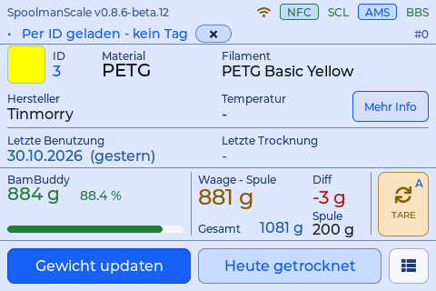

# SpoolmanScale – Eifel-Joe-Fork

Dies ist die Doku des [Eifel-Joe-Forks](https://github.com/Eifel-Joe/SpoolmanScale) von [SpoolmanScale](https://github.com/Niko11111/SpoolmanScale), der ESP32-Filamentwaage mit NFC-Leser und Touchscreen von Niko11111.

{ width="360" }

Sie beschreibt nur, was dieser Fork anders macht. Alles andere, von der Stückliste und der Verkabelung der WT32-SC01 Plus bis zu Tags, Backends und Trocknung, steht in der **[Doku des Originals](https://niko11111.github.io/SpoolmanScale-Docs/de/)** und gilt auch für diesen Fork.

!!! note "Versionen"
    Jede Funktion ist mit dem stabilen Release dieses Forks markiert, in dem sie zuerst kam: *seit 0.8.5* oder *seit 0.8.6*. Das neueste stabile Release ist 0.8.6. Vorabversionen gibt es nur mit **Vorabversionen** an der Waage, siehe [Flashen und Updates](use/updates.md).

## Was dieser Fork dazu hat

| | Seite |
|---|---|
| Waveshare ESP32-S3-Touch-LCD-7 und -7B neben der WT32-SC01 Plus | [Waveshare 7 und 7B](build/waveshare.md) |
| Updates, Releases und Web-Flasher aus diesem Fork | [Flashen und Updates](use/updates.md) |
| Spulen ohne Wiegen und ohne Aufkleber anlegen, mehrere auf einmal; neue Sorte Schritt für Schritt; Kopie mit allen Feldern | [Spulen anlegen](use/spools.md) |
| Zubehör an der Spule, Leergewichte und Spulentypen, Etikett anheben | [Wiegen und Leerspulen](use/weighing.md) |
| Brother QL-810W/820NWB über WLAN, größere Etikettenschrift, Farbe als RGB | [Brother-Etikettendrucker](use/brother.md) |
| Klipper-Drucker im AMS-Fenster, Drucker aus einer Liste wählen | [Klipper-Drucker](use/klipper.md) |
| Einstellungs-Sicherung, Testseite der Waage, Downloads in BamBuddy | [Weboberfläche](use/web.md) |

## Welche Platinen

| Platine | Display | Stand in diesem Fork |
|---|---|---|
| Waveshare ESP32-S3-Touch-LCD-7B | 1024×600 | an Hardware geprüft |
| Waveshare ESP32-S3-Touch-LCD-7 | 800×480 | gebaut, nicht an Hardware geprüft |
| WT32-SC01 Plus | 480×320 | gebaut, nicht an Hardware geprüft; die Platine des Originals |

Alle drei zeigen dieselben Schirme: die 480×320-Oberfläche der WT32-SC01 Plus, auf den Waveshare-Platinen vergrößert, bis sie das Panel füllt. Die Bildschirmfotos dieser Doku stammen von einer Waveshare 7B und zeigen diese Oberfläche in ihrer eigenen Größe.

## Probleme und Fragen

Probleme mit den Waveshare-Platinen oder mit etwas, das dieser Fork dazu hat: [Issue beim Fork öffnen](https://github.com/Eifel-Joe/SpoolmanScale/issues). Bitte nicht beim Original melden.
