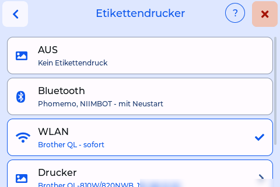

# Brother-Etikettendrucker

*seit 0.8.5* · jedes Backend

Neben den Bluetooth-Druckern des Originals (Phomemo, NIIMBOT, siehe [Doku des Originals](https://niko11111.github.io/SpoolmanScale-Docs/de/use/printers/)) druckt dieser Fork auf einem **Brother QL-810W oder QL-820NWB über WLAN**: Die Waage zeichnet das Etikett und schickt es selbst an den Drucker, ohne PC oder App. Geprüft an einem QL-820NWBc mit Etiketten **DK-11209** (62 × 29 mm). Nur schwarz.

## Einrichten

1. **Am Drucker** einmal im Menü des Druckers den Befehlsmodus **Raster** einstellen. Neue Drucker stehen auf „P-touch Template“ und drucken dann nichts.
2. **An der Waage: Einstellungen → Verbindung → Etikettendrucker** wählt **Aus**, **Bluetooth** oder **WLAN**. WLAN gilt sofort; für Bluetooth startet die Waage neu. Die Einstellungen eines Bluetooth-Druckers bleiben gespeichert.

    { width="360" }

3. **Weboberfläche → Drucker:** die IP-Adresse des Druckers (er muss im selben WLAN sein), das Etikett und die Druckposition mit einer Kalibrierseite. Ein Probedruck zeigt sein Ergebnis auch an der Waage.

## Drucken

Wie bei jedem Etikettendrucker: **Mehr Info → Etikett drucken**, nach dem Anlegen einer Spule (**Etikett drucken?**) oder aus dem Etiketten-Editor im Browser (**Etiketten**). Die Karte „Gesendet“ verschwindet nach 2 s; meldet der Drucker in den 10 s danach ein Problem oder bricht die Verbindung ab, kommt die Karte zurück und sagt es. Ein Etikett hält die Waage nicht auf.

## Etikettenschrift

*0.8.6 Vorabversion* · jeder Drucker, für den die Waage zeichnet (Brother, Bluetooth-Drucker, die Vorschau)

- Die Zeilen unter dem Kopf nehmen die **größte Schrift**, mit der jede gewählte Zeile in Breite und Höhe aufs Etikett passt, ohne den QR-Code zu verkleinern. Weniger Zeilen, größere Schrift.
- **Farbe als RGB** im Etiketten-Editor (Spulen- und Filament-Etiketten, ab Werk aus) fügt unter der Farbe eine Zeile wie „RGB: 242, 242, 232“ hinzu. Bambu Studio und OrcaSlicer nehmen eine Farbe als RGB, so lässt sie sich dort genau so einstellen, wie sie gespeichert ist. Nicht bei durchsichtig, mehrfarbig oder ohne gültigen Hex-Wert.
