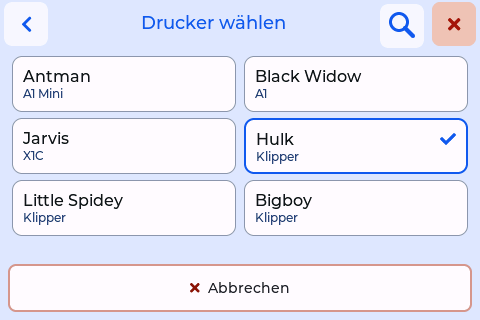
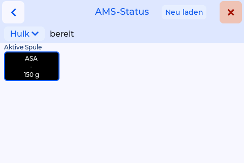

# Klipper-Drucker

*seit 0.8.6* · Spoolman, oder BamBuddy, das seine Spulen in Spoolman speichert

Das AMS-Fenster des Originals zeigt die Bambu-Drucker von FilaMan oder BamBuddy (siehe [Doku des Originals](https://niko11111.github.io/SpoolmanScale-Docs/de/use/ams/)). Dieser Fork fügt Klipper-Drucker hinzu: Eine gewogene Spule kommt über Moonraker in ein Gate, eine Lane oder ein Werkzeug eines Klipper-Druckers. BamBuddy erfährt nichts von diesen Druckern.

## Was der Drucker braucht

- **Moonraker mit einem Abschnitt `[spoolman]`**, der auf **denselben Spoolman** zeigt wie die Waage.
- **Moonraker muss der Waage vertrauen:** die Adresse der Waage in Moonraker unter `trusted_clients` eintragen oder an der Waage einen API-Schlüssel von Moonraker angeben.

## Drucker eintragen

**Weboberfläche → Klipper → Drucker hinzufügen:** ein Name, die Adresse (IP oder Hostname), der Port (7125, wenn nicht geändert) und, nur wenn Moonraker der Waage nicht vertraut, ein API-Schlüssel. Bis zu 64 Drucker. Der Name hat höchstens 23 Zeichen (Umlaute und Akzente zählen doppelt) und wird zum Lagerort der Spulen in diesem Drucker.

Nach jedem Speichern und mit **Verbindung testen** prüft die Waage den Drucker. Der Test liest nur. Er meldet, in dieser Reihenfolge:

| Schritt | Meldung, wenn er scheitert |
|---|---|
| Moonraker antwortet | Nicht erreichbar - Adresse und Port prüfen |
| Zugang erlaubt | Zugang verweigert - Adresse der Waage in Moonraker als vertraut eintragen (trusted_clients) oder API-Schlüssel angeben |
| Klipper bereit | Klipper nicht bereit |
| Spoolman in Moonraker eingerichtet | Spoolman ist in Moonraker nicht eingerichtet ([spoolman]) |
| Moonraker damit verbunden | Spoolman eingerichtet, aber nicht verbunden |
| Es ist der Spoolman der Waage | Anderer Spoolman als die Waage - Zuordnen gesperrt |

Geht alles durch: „Verbunden: <was der Drucker hat>, Spoolman verbunden, derselbe Spoolman“. Zuordnen geht nur zu einem Drucker, dessen Test bestanden ist.

## Was die Waage erkennt

Nichts von Hand zu wählen. Der Test findet heraus, was der Drucker hat:

- eine **Happy-Hare**-MMU mit ihren Gates;
- eine **AFC**-Einheit (Box Turtle und andere) mit ihren Lanes;
- **Werkzeug-Makros** `T0`, `T1`, … mit einer Variablen `spool_id`, die Konvention von Mainsail und Fluidd für Werkzeugwechsler;
- sonst ein Feld für die **aktive Spule** von Moonraker.

## Im AMS-Fenster

Der Druckerknopf oben im AMS-Fenster zeigt den Namen des Druckers mit einem Pfeil. Antippen öffnet **Drucker wählen**: alle Drucker als Knöpfe in zwei Spalten, mit Name und Art (das Bambu-Modell oder „Klipper“ mit seinen Werkzeugen, MMU-Fächern oder AFC-Fächern); der aktuelle hat einen Haken. Eine Lupe sucht in Namen und Arten: „jar“ findet Jarvis, „klipper“ jeden Klipper-Drucker. **Abbrechen** oder Zurück lässt alles, wie es war. Das gilt auf allen drei Platinen und auch für Bambu-Drucker.

{ width="360" }

Ein Klipper-Drucker zeigt seine Gates, Lanes oder Werkzeuge in Vierergruppen, mit der Spule, die jedes hält: Farbe und Material vom Drucker oder aus Spoolman, die Gramm aus Spoolman.

{ width="360" }

**Zuordnen:** Spule wiegen, dann **in welches Fach?** → der Klipper-Drucker → das Feld. Oder **Mehr Info → Ins AMS**. Der Drucker führt die Spule dann dort (wie Mainsail oder Fluidd zeigen), und ihr Lagerort in Spoolman wird der Name des Druckers. Happy Hare im Modus `push` oder `pull` setzt den Lagerort selbst.

## Die verdrängte Spule bekommt ihren alten Lagerort zurück

Ordnet die Waage eine Spule einem Klipper-Drucker zu, merkt sie sich den bisherigen Lagerort der Spule in Spoolman, in einem Zusatzfeld **Lagerort vor dem Drucker**, das die Waage einmal anlegt. Kommt später eine andere Spule ins selbe Feld, bekommt die verdrängte ihren alten Lagerort zurück, sofern ihr Lagerort noch der Name des Druckers ist. Ohne gemerkten Lagerort wird ihr Lagerort geleert.

Nicht bei Happy Hare in `push`/`pull`. Eine Spule, die am Drucker selbst getauscht wird, etwa in Mainsail, bemerkt die Waage nicht. Mit BamBuddy geht das direkt an Spoolman, weil BamBuddy Zusatzfelder nicht weiterreicht.
