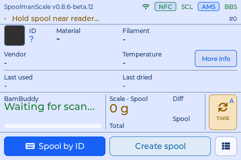
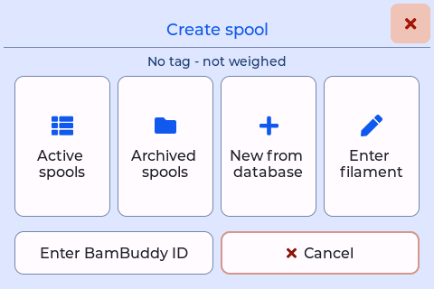
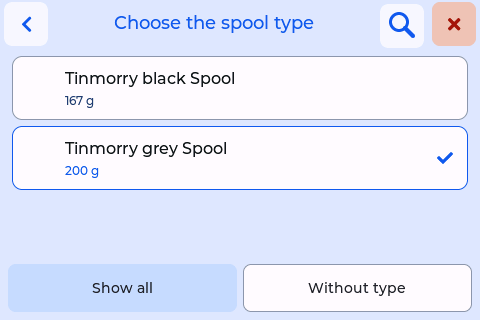
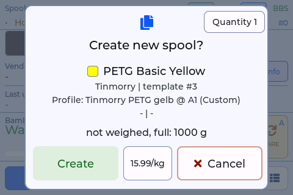
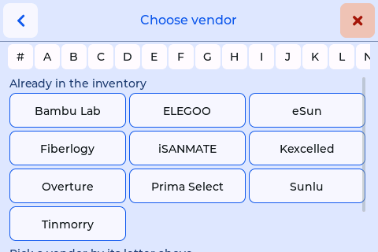
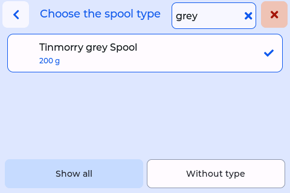
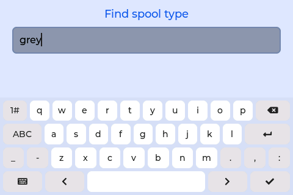

# Creating spools

The original creates a spool at the scale from a Bambu tag or a blank NTAG, and copies a spool that is on the scale (see the [original's documentation](https://niko11111.github.io/SpoolmanScale-Docs/use/first-spools/)). This fork adds:

- creating spools **without weighing and without a tag**, several at once, for a delivery;
- **Enter filament**, for a filament that is in neither your inventory nor the filament database;
- with BamBuddy and Spoolman, a **copy that takes over all fields** of its template;
- the **spool type** when a spool is created from a Bambu tag;
- **searching** the lists, and keyboards in the scale's language.

## Create a spool without weighing and without a tag

*since 0.8.6*

For rolls that are still sealed, or that you want in the inventory before they ever lie on the scale.

1. With no spool on the screen, the right button of the main screen reads **Create spool** (with a spool on the screen it reads **Dried today**).

    { width="360" }

2. Choose the source: a copy of an **Active spool** or an **Archived spool**, a copy by its ID (**Enter Spoolman ID**), **New from database** or **Enter filament**.

    { width="360" }

3. The spool is **not weighed**, even if something lies on the scale: it starts full, with the filament weight of its source as its initial weight. If the source has none, the card asks for it with **Filament** (100 to 5000 g).
4. With BamBuddy and Spoolman the list of spool types comes first, without a weight (see [Weighing and empty spools](weighing.md)).

    { width="360" }

5. **Create**. The scale shows the new spool as after **Spool by ID**; the status line reads "Spool <no.> created - no tag". For a Bambu Lab roll it reads "Spool <no.> - read chip before AMS" instead: put the roll's chip on the reader before the roll goes into an AMS, otherwise BamBuddy creates a second spool for it.
6. **Select location**: the same list as **More info → Location**, whatever *Location on removal* is set to. A copy already has its template's location; the list comes anyway. Closing it without a choice leaves the location as it is.
7. With a label printer set up: **Print label?** – it prints as **More info → Print label** does, with the location on it.

A tag is linked later, when the roll is opened: put the tag on the reader and choose **Link**, as for any spool.

### Several identical spools

{ width="360" }

On the card, **Quantity 1** at the top right opens the number of identical spools, up to 10. They get the same source, filament, spool type, filament weight and price and are created one after another. If one fails, the scale stops, keeps the ones it made and names them. Afterwards an overview lists every new number, the location is chosen once for all, and **Print <n> labels?** prints one label per spool.

### Into AMS

**More info → Into AMS** (BamBuddy with an AMS) opens the bay picker for any spool on the screen that is not archived, with or without a tag and with or without a load cell. The weight stays as it is.

## Enter filament

*since 0.8.5*

For a spool whose filament is in neither your inventory nor the filament database. Where you find it:

- **New / Copy → Enter filament**,
- on the card for an unknown tag, **Not in Spoolman** (it names your backend) **→ Enter filament**,
- in **New from database**, at the end of the maker list: **Not listed? Enter it here**,
- in **Create spool** (see above).

{ width="360" }

The steps are maker, material, line, colour, filament weight and spool. In each step you pick from the filament database and your own inventory first; **Add new** is only for what is missing. A name you type that is close to an existing one gets a hint ("Already there: …"), so the same filament does not end up twice under two spellings. Colours are offered from the maker's other materials as well.

After the steps comes the usual create card (spool type, price, link the tag).

- **Density:** Spoolman needs one for every new filament. The scale also looks the product name up in the filament database (Bambu "Support for ABS" → 1.16 g/cm³). Where none is found, the left button of the card reads **Density** and opens a number pad (0.50 to 4.00 g/cm³). *since 0.8.6*
- **Names behind BamBuddy:** a new filament is named "<material>" or "<material> <line>", as BamBuddy names its own; the colour name goes onto the spool. BamBuddy renames a filament that way on every change anyway.

## Copy with all fields

*since 0.8.5* · BamBuddy with Spoolman

A copy hangs on its template's Spoolman filament and takes over the slicer profile, the profiles per printer model, the K profiles, the price per kg, the storage location and the suppliers. The copy card shows them, and the price per kg can be changed there. If something could not be copied, the scale says what ("Copied, without: …").

Why it matters: BamBuddy puts a spool's profile into the AMS bay, and the AMS backup spool only pairs bays with the same profile and colour. A copy without the profile would break that.

## Spool type when creating from a Bambu tag

*since 0.8.6* · BamBuddy, with or without Spoolman

**Create spool from tag?** first asks for the spool type, as copying and **New from database** do. The list shows the "Bambu Lab" types with the one nearest 250 g marked, and **Without type**, which creates the spool as before. A refill on another spool so gets its real empty weight. The list only comes when a spool lies on the scale.

## Search and keyboards

*since 0.8.6*

- A **magnifier** in the header of the spool type list and of the colour lists (**Enter filament**, colour step; **New from database**, colour families and entries) opens the keyboard. After a word, the list shows only entries whose name contains it, upper or lower case alike, umlauts and accents included. The word stands in the header with an × that ends the search.

    { width="360" }

- The **keyboards** follow the scale's language: German QWERTZ with ä ö ü ß, French AZERTY with é è à ç and the other accents on a page of their own, English as before. The keyboard for the WiFi password keeps the language's letter order without umlauts.

    { width="360" }
