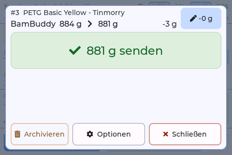
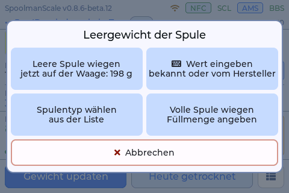

# Wiegen und Leerspulen

Das Wiegen selbst funktioniert wie im Original (siehe [Doku des Originals](https://niko11111.github.io/SpoolmanScale-Docs/de/use/weighing/)). Dieser Fork fügt Zubehör hinzu, das von jedem Gewicht abgeht, Leergewichte und Spulentypen mit BamBuddy und Spoolman, und eine Frage, wenn eine Spule mehr wiegt, als ihr Etikett sagt.

## Zubehör an der Spule

*seit 0.8.5* · jedes Backend

Ein NFC-Aufkleber in einem Halter, der von Spule zu Spule wandert, ein Filament-Clip, ein Halter: Ihr Gewicht geht zusätzlich zur Leerspule ab, überall, wo aus dem Messwert ein Filamentgewicht wird, auch beim Wiegen einer leeren Spule.

- **Weboberfläche → Einstellungen → Zubehör an der Spule:** bis zu 8 Teile mit Name und Gewicht. Die angekreuzten (bis zu 3) gelten für jede Spule.
- **An der Waage:** Der Chip oben rechts im Wiege-Fenster öffnet **Zubehör an dieser Spule**. Eine Wahl dort gehört zu dieser Spule, und die Waage merkt sie sich.

    { width="360" }

## Leergewicht und Spulentypen

*seit 0.8.5* · BamBuddy mit Spoolman

BamBuddy führt einen Katalog leerer Spulen (Hersteller, Name, Gewicht). Die Waage bietet sie als **Spulentypen** an und speichert das gewählte Gewicht als eigenes Leergewicht der Spule in Spoolman. Eine Spule ohne eigenes erbt das Leergewicht ihres Filaments oder ihres Herstellers, wie in Spoolman üblich.

**Wiege-Fenster → Optionen → Leergewicht der Spule** bietet vier Wege:

{ width="360" }

| Wahl | Was passiert |
|---|---|
| **Leere Spule wiegen** | die leere Spule, die jetzt auf der Waage liegt, ohne ihr Zubehör |
| **Wert eingeben** | ein bekanntes Gewicht oder das des Herstellers |
| **Spulentyp wählen** | **Spulentyp wählen**: zuerst die Typen des Herstellers, **Alle zeigen** für alle Typen, eine Lupe zum Suchen, **Neu anlegen** für einen fehlenden Typ |
| **Volle Spule wiegen** | eine ungeöffnete Spule auf der Waage und ihre Füllmenge: Leergewicht = Messwert ohne Zubehör minus Füllmenge |

**Erstes Wiegen einer unbenutzten Spule:** Hat die Spule kein passendes eigenes Leergewicht, schlägt die Waage den Spulentyp vor, der zum Messwert passt. **Gemessen nehmen** behält das gemessene Leergewicht, **Anderer Typ** öffnet die Liste, **Später** lässt die Spule, wie sie ist. Solange die Frage offen ist, wartet das automatische Senden.

**Ein neuer Spulentyp** aus einer leeren Spule: **Einstellungen → Spulen & Waage → Leerspule anlegen**. Leere Spule auflegen, das Zubehör daran antippen, **Weiter**, Namen geben. Der Typ kommt in BamBuddys Katalog.

Auch beim Anlegen an der Waage wird nach dem Typ gefragt, siehe [Spulen anlegen](spools.md).

## Etikett anheben

*seit 0.8.5* · BamBuddy mit Spoolman

Spoolman deckelt das Restgewicht beim Etikett- (Nenn-)Gewicht. Liegt eine Wägung mehr als 2 g über dem Etikett, fragt die Waage zuerst, statt die Differenz zu verlieren: **Etikett auf <n> g anheben** setzt das Etikett auf das gewogene Filament, **Etikett behalten** speichert das Etikettengewicht. Mit BamBuddys eigenem Inventar fragt schon das Original genauso.
